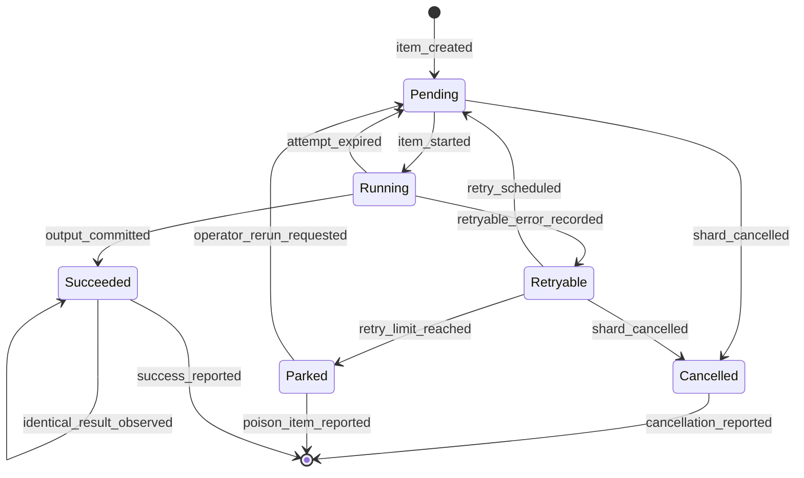
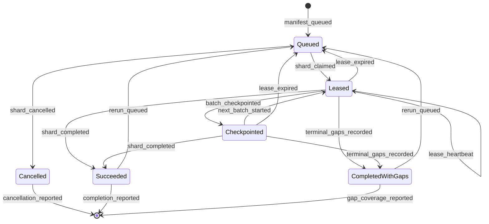

# Sharded, resumable ingestion and extraction jobs

## Status and scope
This note defines a proposed durable job protocol for ingestion and the ingest-time
model read. It does not change product behavior. The design extends
the current SQLite claim and recovery patterns in `jobs.py`, `ingestion.py`,
`workflow_jobs.py`, and migration `0003_scalable_ingestion.sql`. It also follows
the saved-outcome and visible-coverage approach in the full-text review budget.
The goal is for the same frozen input set to converge on the same committed
records after a crash, restart, or rerun. A worker may repeat computation after
a lease expires, but the commit protocol must make that computation visible at
most once. Failed and unprocessed inputs remain visible in measured coverage.
This is a design estimate for a local-first by default deployment. The scale
thresholds and throughput assumptions below must be measured before adoption.

## Terms and identities
* A **source id** identifies an immutable source version, not a mutable path.
* An **item** is one source id at one schema and extractor version.
* A **shard** is an ordered, bounded sequence of items processed as one claim.
* A **manifest** is the immutable description of that sequence and its inputs.
* An **attempt** is one worker's lease-fenced execution of a shard.
* A **checkpoint** is the durable status of a contiguous committed prefix plus
  explicit terminal exceptions within that prefix.
Every persisted output uses a deterministic identity derived from matter id,
source id, input digest, schema version, extractor version, and output kind.
That key is the uniqueness boundary for a successful result.

## Shard manifest
The coordinator freezes a canonical manifest before queueing work. Its logical
record contains:
| Field | Meaning |
| --- | --- |
| `manifest_version` | Version of the canonical serialization rules. |
| `shard_id` | Digest-derived stable id for this manifest. |
| `matter_id` | Isolation boundary; never inferred from an item. |
| `schema_version` | Output schema expected by the commit path. |
| `extractor_version` | Exact extraction or ingest-time model recipe version. |
| `created_from` | Stable plan or rerun id for audit, excluded from identity. |
| `items` | Ordered records of ordinal, source id, input digest, and byte size. |
| `manifest_digest` | SHA-256 of the canonical identity-bearing fields. |
Canonical serialization uses UTF-8 JSON, sorted object keys, fixed field types,
and the manifest item order. It excludes `shard_id`, `manifest_digest`,
timestamps, queue priority, attempts, and worker ids. `shard_id` is namespaced
from `manifest_digest`. The manifest is
insert-only, and a digest collision with different canonical bytes is a hard
error.
Shard construction is deterministic for a frozen plan: sort sources by the
priority tuple below, then source id, and split using versioned item-count and
byte-count boundaries. Thus the same frozen inputs, versions, and sharding
policy produce the same manifests. An existing successful item is joined by
its deterministic identity rather than recomputed. A rerun therefore converges
to the same outputs and status, while a changed digest or version is new work.
Per-item manifest state is stored separately from immutable manifest content:
`pending`, `running`, `succeeded`, `retryable`, `parked`, or `cancelled`.
Status rows include attempt count, last error id, timing totals, token counts,
and committed output identity. No status mutation changes manifest identity.

## Priority and queue construction
The queue orders eligible shards by this stable tuple:
1. Explicit shard reruns, oldest request first.
2. Shards containing the anchor case, then smaller byte size first.
3. Other small-file shards, smaller byte size first.
4. Remaining bulk shards, oldest creation time first.
5. `shard_id` as the final deterministic tie breaker.
The anchor set is frozen in the plan. The small-file cutoff is a versioned
policy value recorded with the plan. A rerun jumps the queue but does not
preempt an active lease. Fairness needs an aging rule in implementation so a
steady stream of reruns or anchor work cannot starve bulk work.

## Claiming, leases, and fencing
A claim transaction selects one eligible queued shard, changes it to `leased`,
creates an attempt, increments a monotonic `fence_token`, and records worker id,
lease expiry, and heartbeat time. SQLite uses a short immediate transaction;
Postgres should use row locking with `SKIP LOCKED`. Only the attempt holding the
current fence token may heartbeat, checkpoint, or finish that shard.
The worker heartbeats at no more than one third of the lease duration. A
heartbeat conditionally extends expiry only when shard id, attempt id, fence
token, and `leased` state still match. A failed conditional update tells the
worker to discard uncommitted output and stop.
After expiry, a reclaimer transaction marks the old attempt `expired`, advances
the fence token, and returns the shard to `queued`. The new claimant receives
the higher token. A late old worker cannot commit because every write checks
the current token in the same transaction. This enforces one current writer per
shard even if two processes briefly compute the same item.

## Item state diagram
Every arrow label is the transition name recorded in the item event ledger.

`identical_result_observed` is an idempotent no-op against the deterministic
output identity. It records no second success and does not double count timing
or tokens. A digest or version change creates a different item identity rather
than moving a succeeded item backward.

## Shard state diagram
Every arrow label is the transition name recorded in the shard event ledger.

A rerun retains the immutable manifest and prior attempts. If all item results
already match, its claim may immediately take `shard_completed`; otherwise it
processes only pending, retryable, or explicitly selected parked items.

## Checkpoints and output commit
Workers use bounded batches within a shard. Computation writes only to an
attempt-scoped staging area. For each item, the worker records input identity,
candidate output digest, stage timings, token counts, and any error. Staging is
not queryable product output and may be discarded after lease loss.
A checkpoint is one database transaction that:
1. verifies the shard's attempt id, fence token, state, and unexpired lease;
2. validates that each staged result matches its manifest item and versions;
3. inserts final output by deterministic identity, rejecting conflicting bytes;
4. changes successful items to `succeeded` and records error item transitions;
5. advances the committed prefix and aggregate counters once; and
6. records `batch_checkpointed` before committing the transaction.
The transaction makes outputs and item statuses visible together. A rollback
leaves both invisible. Object or file output, if later required, must first be
written under a content digest and then referenced in this transaction; orphan
staging objects are garbage collected only after no live attempt references
them. The design does not permit a mutable final file to be published before
its database checkpoint.
A restart reads the manifest and durable item states. It skips succeeded items,
reschedules retryable items within their limit, and starts at the first pending
ordinal. At most the uncheckpointed in-flight batch is recomputed.

## Failure records and retry policy
Every failed item gets an append-only error record with shard id, source id,
attempt id, stage, reason code, bounded neutral message, retryability, observed
time, input digest, and extractor version. Raw source content, model prompts,
and exception dumps do not belong in this record.
Retry limits are versioned policy, applied per item and per reason class. A
retryable failure moves through `retryable` back to `pending`. Reaching the
limit moves it to `parked`. Deterministic validation failures may park on the
first attempt. A later explicit rerun can select parked items and creates a new
attempt without deleting their history.
Parked, cancelled, pending, and retryable items remain in coverage. Reports
show counts and bytes by terminal state and reason, plus measured recall where
an evaluation set exists. No item is dropped to make a shard appear complete.
`completed_with_gaps` is distinct from `succeeded`.

## Throughput accounting
Each attempt accumulates monotonic measurements per shard and stage: queue wait,
read, OCR when applicable, parse, chunk, ingest-time model read, validation,
commit, and total wall time. It also records input bytes, items attempted,
items committed, retries, model input tokens, model output tokens, and cached
tokens when the provider exposes them. Unknown token values remain null rather
than zero.
Checkpoint transactions add measurements exactly once using an attempt and
batch sequence uniqueness key. Abandoned computation is reported separately as
wasted work and never added to committed-work totals. Shard summaries feed the
planned benchmark and coverage report, with extractor and schema versions so
unlike runs are not silently combined.
If document conversion later uses Docling, OCR is pinned to Tesseract or
Nemotron OCR and the RapidOCR extra is excluded.

## Ten-thousand-item crash walkthrough
Assume 10,000 synthetic immutable items are deterministically divided into 100
shards of 100, with checkpoint batches of 10. A worker claims shard 42 with
fence token 7. It commits six batches, so 60 outputs and item successes become
visible atomically. It begins items 61 through 70, then is killed before the
checkpoint transaction commits.
The heartbeat stops. After lease expiry, reclamation records token 7 as expired
and queues shard 42. A restarted worker claims it with token 9, reads the same
manifest, skips items 1 through 60, and recomputes 61 through 70. If the killed
worker returns, its token-7 checkpoint condition fails, so its staging output
is discarded. The restarted worker commits token 9 and proceeds through 100.
If the kill happened during the database transaction, atomic commit determines
the outcome: either the whole batch is present and skipped, or none is present
and the batch is recomputed. Deterministic output keys make an identical insert
a no-op and make conflicting bytes a hard failure. Consequently every one of
the 10,000 manifest items ends in success or an explicit visible gap, no item
has two committed outputs, and only the in-flight batch may repeat computation.

## Scale boundary and assumptions
SQLite remains the initial coordination store for a single host. Short claim
and checkpoint transactions, WAL mode, bounded batches, indexed queue fields,
and one database writer at a time may be adequate at 10,000 items. At 1 million
items, the estimate is that heartbeat and checkpoint write contention, queue
index maintenance, event-ledger growth, and cleanup latency may dominate even
when extraction itself is parallel. This is an estimate, not a limit or a
throughput promise.
Postgres is the expected evaluation candidate when multiple hosts need claims
or when measured SQLite write-lock wait, p95 claim latency, checkpoint latency,
or recovery scans exceed an accepted budget. Postgres offers row-level locking
and `SKIP LOCKED`, but does not remove the need for leases, fencing, idempotent
keys, bounded transactions, or coverage accounting.
A scale test should compare SQLite and Postgres with the same synthetic 1
million-item manifests, worker counts, batch sizes, forced crashes, retry mix,
and durability settings. Record claim and checkpoint latency, lock wait, jobs
per second, database growth, restart time, duplicate-key observations, and
coverage reconciliation. The measured result, not item count alone, selects
the job-table backend.

## Open questions for the maintainer
These questions are intentionally unresolved:
1. What item-count and byte-count shard boundaries should the first benchmark
   evaluate?
2. What lease duration, heartbeat interval, and clock-skew allowance are
   acceptable for the single-host path?
3. Which failure reason classes are retryable, and what retry limit applies to
   each class?
4. How should queue aging balance explicit reruns against bulk-ingestion
   starvation?
5. What defines the anchor case when a plan contains several candidate anchor
   sources?
6. Which p95 latency or lock-wait budget should trigger a Postgres evaluation?
7. How long should attempt events, error records, and orphan staging objects be
   retained?
8. Should an explicit rerun include parked items by default or require a
   separate selection?
9. Which tokenizer is authoritative when a model provider does not report token usage?
10. Which coverage fields must be visible in the first user-facing report, and which remain benchmark-only diagnostics?

## Acceptance checklist
* [x] Manifest identity and per-item status are specified.
* [x] Claims, heartbeats, expiry, fencing, and one current writer are specified.
* [x] Per-item checkpoints and atomic commit or discard are specified.
* [x] Anchor, small-file, bulk, and rerun priority are specified.
* [x] Error records, retry limits, parked items, and visible gaps are specified.
* [x] Stage timings and token accounting feed benchmarks and coverage.
* [x] SQLite and Postgres assumptions at 1 million items are marked estimates.
* [x] Open questions are listed without decisions.
* [x] Item and shard diagrams name every transition.
* [x] The 10,000-item crash walkthrough accounts for every manifest item and prevents two committed outputs for one item identity.
